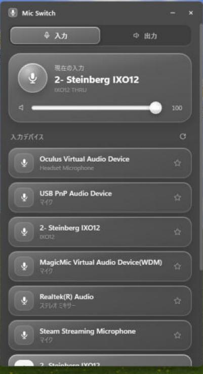

<div align="center">
<h2>Mic Switch</h2>
</div>

<div align="center">

[English](README.md) | **日本語**

</div>

<div align="center">

**マイクとスピーカー**をワンクリックで切り替える、Windows 用の常駐アプリです。<br>USBを挿すたびにサウンド設定を開く手間がなくなります。

</div>

<p align="center"></p>

## アプリの概要

- オーディオの入力と出力を、切り替えられます。
- Discord・Teams・Zoom などの**通話アプリの既定もまとめて切り替えます。**
- **自動切り替え**: ★ を付けたデバイスは、接続した瞬間にwindows上で切り替えられます。
- **タスクトレイに常駐**。Windows 起動時に自動で起動することもできます
- 日本語と英語に対応（Windows の表示言語に合わせるか、地球ボタンのメニューで選べます）
- Rust と [Tauri 2](https://tauri.app/) で作った、約 3 MB の小さなネイティブアプリ
<br>

## 動作環境

- Windows 10 バージョン 1809 以降、または Windows 11（x64）
- [Microsoft Edge WebView2 ランタイム](https://developer.microsoft.com/microsoft-edge/webview2/)（Windows 11 には最初から入っています）
<br>

## インストール

### 方法 A: ダウンロードする

1. [Releases](../../releases) ページから `MicSwitch.exe` をダウンロードします。
2. 好きな場所に置いて起動します。

>コードに署名をしていないので初回起動時に警告が出ます。
<br>
<details>
<summary><b>方法 B: ソースからビルドする</b></summary>

```powershell
git clone <このリポジトリ>
cd mic-switch
.\setup.cmd
```

>`setup.cmd`の中身は `setup.ps1`です。<br>
>実行すると、管理者権限なしで次の作業をまとめて行います。
>1. Rust が無ければ rustup でインストール
>2. MSVC の C++ ビルドツールを確認し、無ければ `winget` でのインストールを提案
>3. リリースビルド
>4. `MicSwitch.exe` を `%LOCALAPPDATA%\Programs\MicSwitch` に配置し、デスクトップとスタートメニューにショートカットを作成

オプション:

| オプション | 説明 |
|---|---|
| `-InstallDir <パス>` | インストール先を変更（例: `D:\Apps\MicSwitch`） |
| `-RustDir <パス>` | Rust を `%USERPROFILE%` ではなく指定フォルダにインストールする |
| `-NoShortcut` | ショートカットを作らないようにする |
| `-Uninstall` | Rustやビルドツール以外の Mic Switch関連すべてを削除 |

```powershell
.\setup.cmd -InstallDir D:\Apps\MicSwitch -RustDir D:\dev
```

</details>

## 使い方

| やりたいこと | 操作 |
|---|---|
| 入力と出力の一覧を切り替える | 上部のセグメントコントロール |
| 既定のデバイスにする | デバイスのカードをクリック |
| 接続したら自動で切り替える | カードの ★ をクリック |
| 言語を変える | 地球ボタン →「自動 / 日本語 / English」 |
| ミュート・音量 | 上部の丸いボタンとスライダー |
| ウィンドウを閉じる | × ボタン（アプリはトレイで動き続けます） |

## 設定の保存場所

- `MicSwitch.exe` のあるフォルダに書き込めるなら、その中の `data\` に保存します。
- 書き込めない別のディレクトリに置いた場合は `%LOCALAPPDATA%\MicSwitch` に保存します。
- 「Windows 起動時に常駐」をオンにすると、`HKCU\Software\Microsoft\Windows\CurrentVersion\Run\MicSwitch` に登録します。

## 仕組み

Windows には既定のオーディオデバイスを変える公開 API がありません。Mic Switch は、同じ種類の他のツールや Windows のサウンド設定画面と同じく、非公開の `IPolicyConfig` COM インターフェースを使っています。

## 開発

```powershell
cargo build --release        # 出力先: target\release\mic-switch.exe
```

| パス | 内容 |
|---|---|
| `src/audio.rs` | Core Audio のラッパー（デバイス一覧、既定の変更、音量） |
| `src/main.rs` | Tauri アプリ本体、トレイ、デバイス監視、コマンド |
| `src/config.rs` | 設定ファイルとスタートアップ登録 |
| `ui/` | 画面（HTML / CSS / JS のみ。ビルド不要） |
| `tools/make-icon.ps1` | `icons/` を作り直すスクリプト |

`v0.1.0` のようなタグを push すると、GitHub Actions で exe をビルドしてリリースに添付します。

## ライセンス

[MIT](LICENSE)
