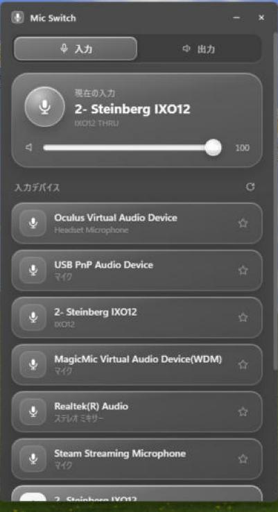

<div align="center">
<h2>Mic Switch</h2>
</div>

<div align="center">

**English** | [日本語](README.ja.md)

</div>

A Windows tray app that switches your **microphone and speaker** in one click.<br>No more opening Sound settings every time you plug in a USB device.

<p align="center"></p>

## Overview

- Switches your audio input and output.
- **Also switches the default for communication apps** such as Discord, Teams and Zoom.
- **Auto-switch**: star (★) a device and Windows switches to it as soon as it is plugged in.
- **Lives in the system tray**, and can start automatically with Windows
- English and Japanese UI (follows the Windows display language, or pick one from the globe menu)
- A small native app (~3 MB) built with Rust and [Tauri 2](https://tauri.app/)
<br>

## Requirements

- Windows 10 version 1809 or later, or Windows 11 (x64)
- [Microsoft Edge WebView2 Runtime](https://developer.microsoft.com/microsoft-edge/webview2/) (preinstalled on Windows 11)
<br>

## Install

### Option A: Download

1. Download `MicSwitch.exe` from the [Releases](../../releases) page.
2. Put it anywhere you like and run it.

>The exe is not code-signed, so Windows shows a warning the first time you run it.
<br>
<details>
<summary><b>Option B: Build from source</b></summary>

```powershell
git clone <this repository>
cd mic-switch
.\setup.cmd
```

>`setup.cmd` is a wrapper around `setup.ps1`.<br>
>It does the following in one go, without administrator rights:
>1. Installs Rust via rustup if it is missing
>2. Checks for the MSVC C++ build tools and offers to install them with `winget` if they are missing
>3. Builds the release binary
>4. Puts `MicSwitch.exe` in `%LOCALAPPDATA%\Programs\MicSwitch` and creates Desktop and Start menu shortcuts

Options:

| Option | Description |
|---|---|
| `-InstallDir <path>` | Install somewhere else (e.g. `D:\Apps\MicSwitch`) |
| `-RustDir <path>` | Install Rust in this folder instead of `%USERPROFILE%` |
| `-NoShortcut` | Do not create shortcuts |
| `-Uninstall` | Remove everything related to Mic Switch, except Rust and the build tools |

```powershell
.\setup.cmd -InstallDir D:\Apps\MicSwitch -RustDir D:\dev
```

</details>

## Usage

| Action | How |
|---|---|
| Switch input / output list | Segmented control at the top |
| Make a device the default | Click its card |
| Auto-switch when plugged in | Click ★ on the card (and keep **Auto-switch** on in Settings) |
| Change language | Globe button in the title bar → Automatic / 日本語 / English |
| Auto-switch / Start with Windows | Settings button (sliders icon) in the title bar |
| Mute / volume | Round button and slider at the top |
| Hide the window | × button — the app keeps running in the tray |
| Open again / quit | Left-click the tray icon / right-click → Quit |

## Where settings are stored

- If the folder containing `MicSwitch.exe` is writable, settings live next to it in `data\` (portable mode).
- Otherwise (e.g. under `Program Files`) they go to `%LOCALAPPDATA%\MicSwitch`.
- "Start with Windows" adds `HKCU\Software\Microsoft\Windows\CurrentVersion\Run\MicSwitch`.

## How it works

Windows has no public API for changing the default audio device. Like other tools of this kind (and the Sound settings page itself), Mic Switch uses the undocumented `IPolicyConfig` COM interface. It has been stable since Windows 7, but a future Windows update could change it.

Device changes are detected by polling the device list every 1.5 seconds.

## Development

```powershell
cargo build --release        # output: target\release\mic-switch.exe
```

| Path | Contents |
|---|---|
| `src/audio.rs` | Core Audio wrapper (enumerate devices, set default, volume) |
| `src/main.rs` | Tauri app, tray icon, device watcher, commands |
| `src/config.rs` | Settings file and startup registration |
| `ui/` | Front-end (plain HTML / CSS / JS, no build step) |
| `tools/make-icon.ps1` | Regenerates `icons/` |

Pushing a tag such as `v0.1.0` builds the exe on GitHub Actions and attaches it to a release.

## License

[MIT](LICENSE)
